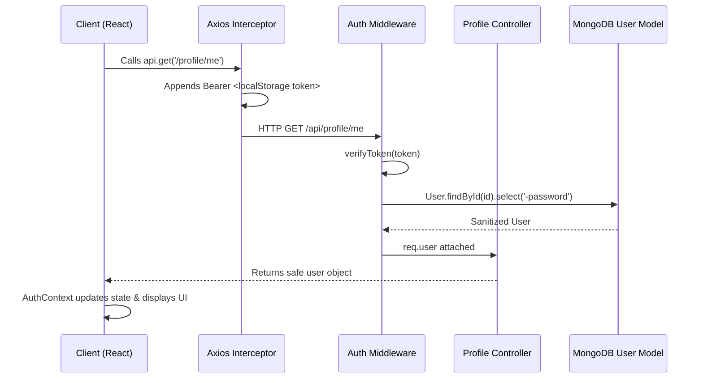
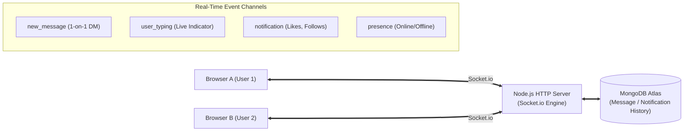

# Social Media Application — Demo Session Presentation Slides

> **Project:** Full-Stack Social Media Platform  
> **Repository:** `Malik2627/SOCIAL_MEDIA`  
> **Target Audience:** Engineering Team, Project Stakeholders & Evaluators  
> **Format:** 11-Slide Master Outline with Speaker Notes and Visual Architecture

---

## Slide 1: Title & Project Scope

### Visual Layout
```text
┌────────────────────────────────────────────────────────────────────────┐
│                                                                        │
│                      SOCIAL MEDIA APPLICATION                          │
│               Next-Generation MERN + Real-Time Engine                  │
│                                                                        │
│       Repository: Malik2627/SOCIAL_MEDIA                               │
│       Workspace:  D:\Socialmedia                                       │
│       Status:     Phases 1–3 Verified (Steps 1–5E)                     │
│                   Immediate Next: Step 5F-A (Cloudinary Upload)        │
│                                                                        │
└────────────────────────────────────────────────────────────────────────┘
```

### Key Bullet Points
- **Vision:** High-performance, mobile-responsive, full-stack social media network.
- **Core Pillars:** Seamless identity, interactive social feeds, instant real-time messaging, and secure media sharing.
- **Engineering Philosophy:** Incremental step-by-step verification, strict schema validation, zero-trust token security, and clean separation of concerns.

### Speaker Notes
> "Welcome everyone. Today we are presenting the architecture, current implementation status, and development roadmap of our full-stack Social Media Application. We are building a robust platform designed for scale using modern web standards. As of today, our foundational architecture, secure token-based authentication system, protected client routing, and profile management engine are 100% completed, verified, and regression-free."

---

## Slide 2: Key Features & User Journey

### Visual Layout
```
[Visitor] ──► [Register / Login] ──► [Authenticated Home Dashboard]
                                              │
          ┌───────────────────────────────────┼───────────────────────────────────┐
          ▼                                   ▼                                   ▼
 [Profile Management]                 [Social Timeline]                   [Live Community]
  • Custom Bio & Avatar                • Create Posts (Photos/Text)        • 1-on-1 Real-Time Chat
  • Followers & Following              • Likes & Nested Comments           • Instant Push Notifications
  • Edit Profile in Real-Time          • Follower Post Stream              • Active Online Indicators
```

### Key Bullet Points
- **Frictionless Onboarding:** Quick account creation with immediate validation and automatic JWT generation.
- **Personalized Profile:** Granular profile customizer with live avatar preview, handle reservation, and bio limits.
- **Dynamic Content Feed:** Rich media posts with infinite scroll, interactive engagement (likes/comments), and chronological timelines.
- **Real-Time Connections:** Low-latency direct messaging and event-driven notifications powered by Socket.io.

### Speaker Notes
> "Here is our core user journey. Everything begins with secure onboarding. Once authenticated, users land on an authenticated dashboard and can personalize their identity. From there, users can create multimedia posts, explore connections, follow other creators, and communicate in real time. We have deliberately partitioned our features into independent modules so each can be developed and scaled cleanly."

---

## Slide 3: Technology Stack (MERN + Socket.io + Cloudinary)

### Visual Layout
```text
┌─────────────────────────────────────────────────────────────────────────────┐
│                          MODERN TECHNOLOGY STACK                            │
├──────────────────────────────┬──────────────────────────────────────────────┤
│ Frontend Client              │ React 19.3 • Vite 7.3 • React Router 7.18    │
│ HTTP Client & Quality        │ Axios 1.21 • Oxlint 1.90                     │
│ Backend Runtime & Framework  │ Node.js v24+ • Express 5.3                   │
│ Database & Object Modeling   │ MongoDB Atlas • Mongoose 9.12                │
│ Real-Time Communication      │ Socket.io 4.8 (Server & Client)              │
│ Security & Cryptography      │ bcryptjs 3.0 • jsonwebtoken (JWT) 9.0        │
│ Media Upload & Storage       │ Multer 2.5 (Memory) • Cloudinary 2.11 (CDN)  │
└──────────────────────────────┴──────────────────────────────────────────────┘
```

### Key Bullet Points
- **React 19 & Vite 7:** Sub-second build times, instant Hot Module Replacement (HMR), and concurrent UI rendering.
- **Express 5 & Mongoose 9:** Modern, asynchronous REST API with native Promise error handling and strict data schemas.
- **Socket.io 4:** Bi-directional event-driven WebSocket connections for sub-millisecond chat and notification delivery.
- **Cloudinary & Multer:** In-memory upload stream buffering with strict 5MB size limits, MIME-type checks, and global CDN delivery.

### Speaker Notes
> "Our technology choices reflect performance, security, and developer speed. We use React 19 with Vite 7 for an ultra-fast client-side experience. Express 5 provides our REST API backend, coupled with Mongoose 9 for strong typing and schema constraints over MongoDB Atlas. Socket.io is pre-configured on both server and client for real-time capabilities. For media, Multer handles in-memory buffering while Cloudinary acts as our distributed media store and CDN."

---

## Slide 4: Architecture & Actual Project Structure

### Visual Layout
```text
D:\Socialmedia
├── backend/
│   ├── config/        db.js (Mongo Atlas) • cloudinary.js • upload.js (Multer)
│   ├── controllers/   authController.js • profileController.js
│   ├── middleware/    authMiddleware.js (Bearer JWT validator)
│   ├── models/        User.js (Mongoose schema)
│   ├── routes/        authRoutes.js (/api/auth) • profileRoutes.js (/api/profile)
│   └── utils/         jwt.js • password.js • userFormatter.js
└── frontend/
    ├── src/components Layout.jsx • Navbar.jsx • ProtectedRoute.jsx • PasswordField.jsx
    ├── src/context    AuthContext.jsx (Token storage & user state)
    ├── src/pages      Home.jsx • Login.jsx • Register.jsx • Profile.jsx
    ├── src/services   api.js (Axios instance + Bearer interceptor)
    └── src/utils      apiError.js • authValidation.js
```

### Key Bullet Points
- **Strict Decoupling:** Complete separation between backend business logic and frontend client presentation.
- **Automated Authorization:** Frontend Axios interceptor dynamically injects `Authorization: Bearer <token>` on every request.
- **Middleware Guard Rails:** Centralized backend middleware (`protect`) intercepts protected routes and attaches verified `req.user`.

### Speaker Notes
> "Here is our actual project directory structure directly from the repository. On the backend, we maintain a clean separation between routes, controllers, models, and utility helpers. On the frontend, `api.js` provides a centralized Axios instance that injects our authentication tokens automatically, while `AuthContext` provides global reactive state to all components."

---

## Slide 5: Live Status: What Is Already Built & Verified

### Visual Layout
```text
╔════════════════════════════════════════════════════════════════════════╗
║                     VERIFIED LIVE CAPABILITIES                         ║
╠════════════════════════════════════════════════════════════════════════╣
║  [✔] Express 5 Server & Health Check APIs (/api/health, /api/health/db)║
║  [✔] User Schema with unique constraints, regex, & hidden passwords    ║
║  [✔] bcryptjs Password Hashing & JWT Signing/Verification (7d expiry)  ║
║  [✔] Bearer Token Auth Middleware (authMiddleware.js)                  ║
║  [✔] Auth REST APIs: POST /register, POST /login, GET /me              ║
║  [✔] React Context & Session Restoration on Page Reload (AuthContext)  ║
║  [✔] Form Validation, Password Visibility Toggles & Error Handling     ║
║  [✔] Protected Routing (/ & /profile guarded via ProtectedRoute)       ║
║  [✔] Global Navigation Bar with Active NavLink state & User Pill       ║
║  [✔] Profile APIs: GET /api/profile/me & PUT /api/profile/me           ║
║  [✔] Live Profile View & Edit UI with Instant Client Sync              ║
║  [✔] Code Quality: Oxlint 0 warnings/0 errors & Clean Vite Build       ║
╚════════════════════════════════════════════════════════════════════════╝
```

### Key Bullet Points
- **100% Verified:** All 14 sub-steps up to Step 5E-B are fully implemented and verified via automated test scripts.
- **Zero Lint Regressions:** Oxlint reports 0 warnings and 0 errors across all 15 source files.
- **Clean Build Pipeline:** Vite produces optimized bundles with zero compilation or packaging warnings.

### Speaker Notes
> "This slide represents our live, verified reality. Everything listed here is built and tested. We have end-to-end authentication working seamlessly: registration, login, token storage, session restoration across browser refreshes, protected routes, and our profile management page. Every single component conforms to strict linting rules and builds cleanly in production."

---

## Slide 6: Component Deep Dive: Authentication & Profile

### Visual Layout


### Key Bullet Points
- **Zero Plain-Text Passwords:** Passwords hashed with `bcryptjs`; MongoDB queries explicitly exclude hashes via `select: false`.
- **Stateless Tokens:** Signed JWTs expire in 7 days; tamper-proof token payload verification.
- **Safety by Design:** Profile update endpoint protects immutable fields (`email`), enforces handle uniqueness, and limits bio length to 250 characters.

### Speaker Notes
> "Let us look at how authentication and profile management interact under the hood. When a user requests their profile, our Axios interceptor attaches the JWT. The backend middleware validates the token signature, checks that the user still exists in MongoDB, strips the password hash, and forwards `req.user` to the controller. Updates follow the same strict path: users cannot modify their email through this endpoint, handles are checked for collisions, and any update updates the global AuthContext without needing a page refresh."

---

## Slide 7: Component Deep Dive: Feed, Likes, Comments & Follow

### Visual Layout
```text
┌────────────────────────────────────────────────────────────────────────┐
│                        SOCIAL ENGINE ARCHITECTURE                      │
├────────────────────────────────────────────────────────────────────────┤
│  Post Model                                                            │
│   • author: ObjectId (Ref: User)       • likes: [ObjectId (Ref: User)] │
│   • caption: String (max 1000 chars)   • commentsCount: Number         │
│   • media: [String (Cloudinary URLs)]  • timestamps: true              │
├────────────────────────────────────────────────────────────────────────┤
│  Social Relationships (User Model)                                     │
│   • followers: [ObjectId (Ref: User)] • following: [ObjectId]          │
│   • Atomic $addToSet / $pull for concurrency protection                │
├────────────────────────────────────────────────────────────────────────┤
│  Timeline Aggregation                                                  │
│   • Feed queries posts where author IN req.user.following              │
│   • Cursor-based pagination for high performance & infinite scroll     │
└────────────────────────────────────────────────────────────────────────┘
```

### Key Bullet Points
- **Atomic Operations:** Uses MongoDB `$addToSet` and `$pull` to guarantee like/follow operations remain idempotent and race-condition free.
- **Optimistic UI Updates:** UI updates like counts and heart icons immediately in React, rolling back only if the API rejects the request.
- **Indexed Aggregations:** Posts and relationships will use compound database indexes (`author`, `createdAt`) to ensure sub-10ms feed generation.

### Speaker Notes
> "Next on our roadmap is the social feed and engagement system. Our Post schema references authors and stores arrays of user likes. Because social media interactions happen concurrently, we use atomic operations like `$addToSet` and `$pull` to prevent duplicate likes or followers. On the frontend, we will implement optimistic UI updates so when a user likes a post, the animation triggers instantly without waiting for network round-trips."

---

## Slide 8: Component Deep Dive: Real-Time Chat & Notifications (Socket.io)

### Visual Layout


### Key Bullet Points
- **Single WebSocket Connection:** One persistent full-duplex TCP stream replaces hundreds of polling HTTP requests.
- **Authenticated Handshake:** Sockets authenticate during connection establishment via JWT query/auth payload.
- **Room-Based Architecture:** Users join private rooms (`user_<id>`) and conversation channels for secure message targeting.
- **Persistent Message Storage:** All chat messages and notifications are simultaneously persisted to MongoDB Atlas for historical retrieval.

### Speaker Notes
> "Real-time communication is powered by Socket.io, which is already integrated into our dependencies on both backend and frontend. Sockets authenticate upon handshake using the user's JWT. When User 1 sends a message to User 2, the event hits our server, writes to MongoDB, and is pushed directly to User 2's socket room with zero polling delay. We use the same architecture to deliver live notifications for likes, follows, and mentions."

---

## Slide 9: Step-by-Step Development Roadmap (Steps 5F-A → 24)

### Visual Layout
```text
┌─────────────────────────────────────────────────────────────────────────────┐
│                       UPCOMING EXECUTION ROADMAP                            │
├────────────────────────────────┬────────────────────────────────────────────┤
│ Phase 4: Media & Identity      │ 5F-A: Cloudinary Foundation (NEXT)         │
│                                │ 5F-B: Avatar API • 5F-C: Upload UI         │
│                                │ Step 6: Public Profiles & User Pages       │
├────────────────────────────────┼────────────────────────────────────────────┤
│ Phase 5: Social Connections    │ Step 7: Follow/Unfollow Engine             │
│                                │ Step 8: User Search & Discovery Engine     │
├────────────────────────────────┼────────────────────────────────────────────┤
│ Phase 6: Post Creation         │ Step 9: Post Model • Step 10: Post APIs    │
│                                │ Step 11: Frontend Post Composer Component  │
├────────────────────────────────┼────────────────────────────────────────────┤
│ Phase 7: Engagement            │ Step 12: Likes Engine • Step 13: Comments  │
│                                │ Step 14: Frontend Comment Thread Drawer    │
├────────────────────────────────┼────────────────────────────────────────────┤
│ Phase 8: Main Social Feed      │ Step 15: Timeline Aggregation API          │
│                                │ Step 16: Infinite Scroll Social Feed       │
├────────────────────────────────┼────────────────────────────────────────────┤
│ Phase 9 & 10: Real-Time Engine │ Steps 17–19: Socket.io Direct Chat         │
│                                │ Steps 20–21: Real-Time Notification Center │
├────────────────────────────────┼────────────────────────────────────────────┤
│ Phase 11–13: Quality & Deploy  │ Step 22: Privacy & Account Settings        │
│                                │ Step 23: Security Hardening & Unit Tests   │
│                                │ Step 24: Docker Container, CI/CD & Deploy  │
└────────────────────────────────┴────────────────────────────────────────────┘
```

### Key Bullet Points
- **Strict Sequential Phasing:** Every step has explicit boundaries, input validation rules, and automated verification requirements.
- **Immediate Next Step:** **Step 5F-A (Cloudinary & Multer Foundation)** prepared and ready for execution.
- **Comprehensive Lifecycle:** Covers the full trajectory from media uploads through real-time chat, automated testing, and cloud deployment.

### Speaker Notes
> "This slide outlines our roadmap from Step 5F through Step 24. We don't build randomly; every feature builds upon the verified foundation of the previous step. Our immediate next step is Step 5F-A, which configures Cloudinary and Multer for secure profile image uploading. Following that, we sequentially build public profiles, social follow relationships, posts, likes, comments, feed aggregation, real-time messaging, and finally, security hardening, testing, and production deployment."

---

## Slide 10: Security Architecture & Reliability

### Visual Layout
```text
┌────────────────────────────────────────────────────────────────────────┐
│                        MULTI-TIER SECURITY MODEL                       │
├────────────────────────────────────────────────────────────────────────┤
│ 1. Data Layer:     • Passwords hashed with bcryptjs (adaptive salt)    │
│                    • Mongoose validation, regex & select: false        │
│                    • Safe toJSON transformations delete sensitive keys │
├────────────────────────────────────────────────────────────────────────┤
│ 2. API & Network:  • Stateless JWTs with 7-day expiration              │
│                    • Bearer token authentication middleware            │
│                    • CORS whitelisting (CLIENT_URL strict match)       │
│                    • Express JSON body validation & error catching     │
├────────────────────────────────────────────────────────────────────────┤
│ 3. Media Upload:   • Multer memory storage (no orphaned disk files)    │
│                    • 5MB strict payload cap & MIME-type validation     │
│                    • Cloudinary CDN isolation & HTTPS-only delivery    │
├────────────────────────────────────────────────────────────────────────┤
│ 4. Environment:    • Gitignored .env files with .env.example templates │
│                    • Non-sensitive database health checks              │
└────────────────────────────────────────────────────────────────────────┘
```

### Key Bullet Points
- **Defense in Depth:** Security implemented across database, application, network, and client layers.
- **Secret Protection:** Zero credentials committed to version control; passwords never logged or returned in responses.
- **Memory-Safe Media Handling:** Uploads are buffered in memory and verified before streaming to cloud storage.

### Speaker Notes
> "Security is not an afterthought in this project; it is built into the architecture. We employ adaptive bcryptjs hashing, stateless cryptographic JWTs, and strict input validation. Uploaded images are restricted to 5 megabytes, validated for safe image formats, and buffered in memory before being sent to Cloudinary, ensuring the server filesystem is never exposed to untrusted user uploads."

---

## Slide 11: Q&A and Next Steps

### Visual Layout
```text
┌────────────────────────────────────────────────────────────────────────┐
│                                                                        │
│                            QUESTIONS & ANSWERS                         │
│                                                                        │
│   Key Discussion Areas:                                                │
│   • JWT Auth & Session Persistence Mechanics                           │
│   • Socket.io WebSocket vs. Polling Performance                        │
│   • Cloudinary & Multer Memory Streaming Efficiency                    │
│   • Incremental Step-by-Step Delivery Process                          │
│                                                                        │
│   IMMEDIATE NEXT MILESTONE:                                            │
│   Step 5F-A — Cloudinary Profile Image Upload Foundation               │
│                                                                        │
└────────────────────────────────────────────────────────────────────────┘
```

### Key Bullet Points
- **Ready for Review:** Verified code and tests available across `backend/` and `frontend/`.
- **Comprehensive Documentation:** Full project overview (`project-overview.md`) and development roadmap (`development-roadmap.md`) available in `docs/demo-session/`.
- **Immediate Next Step:** Execute Step 5F-A (Cloudinary + Multer Foundation) upon approval.

### Speaker Notes
> "Thank you for your time. All our documentation is located in `D:\Socialmedia\docs\demo-session\`. We are now open for questions regarding our architecture, state management, or roadmap. Once aligned, we are ready to proceed with Step 5F-A to implement our real Cloudinary profile picture upload foundation."

