# Social Media Application — Step-by-Step Development Roadmap

> **Project:** Full-Stack Social Media Platform (`D:\Socialmedia`)  
> **Repository:** `Malik2627/SOCIAL_MEDIA`  
> **Development Methodology:** Incremental, test-verified, and security-hardened architectural milestones.

---

## 1. Executive Summary of Progress

The project follows a rigorous, phase-based engineering workflow where each milestone is implemented, linted, compiled, and verified before proceeding to the next.

```
[Phase 1: Foundation] ──────► [Phase 2: Auth Core] ──────► [Phase 3: Auth & Profile UI]
      (COMPLETED)                  (COMPLETED)                    (COMPLETED)
                                                                       │
                                                                       ▼
[Phase 5-7: Posts & Social] ◄── [Phase 4: Cloudinary Upload] ◄─────────┘
        (PLANNED)                    (NEXT STEP: 5F-A)
            │
            ▼
[Phase 8-10: Feed & Chat] ────► [Phase 11-13: Production & Deploy]
        (PLANNED)                           (PLANNED)
```

---

## 2. Completed Milestones (Verified & Tested)

All milestones below have been fully built, functionally verified, lint-checked with `oxlint` (0 errors, 0 warnings), and verified via clean production builds.

| Step | Milestone | Scope & Deliverables | Verification Status |
| :--- | :--- | :--- | :---: |
| **Step 1** | **Workspace & Directory Architecture** | Initialized root project, setup `.gitignore`, established isolated `backend/` and `frontend/` environments. | **`DONE`** (Verified) |
| **Step 2** | **Express Server Initialization** | Setup `backend/server.js`, CORS policies, Express JSON parser, centralized error handler, and `/api/health`. | **`DONE`** (Verified) |
| **Step 3** | **MongoDB Atlas Connection Layer** | Created `backend/config/db.js` with sanitized connection logging, auto-reconnect, and non-sensitive `/api/health/db`. | **`DONE`** (Verified) |
| **Step 4A** | **User Model & Mongoose Schema** | Built `backend/models/User.js` with email regex, lowercase usernames, timestamps, `select: false` passwords, and safe `toJSON` transforms. | **`DONE`** (Verified) |
| **Step 4B** | **Password Hashing & JWT Utilities** | Built `backend/utils/password.js` (`bcryptjs`) and `backend/utils/jwt.js` (`jsonwebtoken`, sign/verify, 7d expiration). | **`DONE`** (Verified) |
| **Step 4C** | **Authentication Middleware** | Built `backend/middleware/authMiddleware.js` (`protect`) verifying Bearer JWT and attaching sanitized `req.user`. | **`DONE`** (Verified) |
| **Step 4D** | **Authentication Controller** | Implemented `backend/controllers/authController.js` handling `register`, `login` (with email lookup), and `getMe`. | **`DONE`** (Verified) |
| **Step 4E** | **Auth Routes & Server Integration** | Mounted `backend/routes/authRoutes.js` at `/api/auth` with public `register`/`login` and protected `getMe`. | **`DONE`** (Verified) |
| **Step 5A** | **Frontend API Service & Auth Context** | Created `frontend/src/services/api.js` (Axios interceptor for Bearer token) and `frontend/src/context/AuthContext.jsx` with session restoration. | **`DONE`** (Verified) |
| **Step 5B** | **Register & Login Pages** | Created `Register.jsx`, `Login.jsx`, `PasswordField.jsx`, and `auth.css` with client validation and error banners. | **`DONE`** (Verified) |
| **Step 5C** | **Protected Routing & Home Dashboard** | Built `ProtectedRoute.jsx` guarding routes, and `Home.jsx` displaying authenticated user status and feature teasers. | **`DONE`** (Verified) |
| **Step 5D** | **Global Navigation & Layout** | Created `Navbar.jsx` (active links, avatar preview, logout) and `Layout.jsx` container wrapping authenticated pages. | **`DONE`** (Verified) |
| **Step 5E-A**| **Backend User Profile API** | Implemented `GET /api/profile/me` and `PUT /api/profile/me` in `profileController.js` and `profileRoutes.js` with email protection. | **`DONE`** (Verified) |
| **Step 5E-B**| **Frontend Profile Management Page** | Built `Profile.jsx` connected to profile API with live editing of name, username, bio, avatar URL, and error handling. | **`DONE`** (Verified) |

---

## 3. Upcoming Milestones (Sequential Implementation Roadmap)

### Immediate Next Implementation Step: Phase 4 — Cloudinary Media Upload

```
┌────────────────────────────────────────────────────────────────────────┐
│  STEP 5F-A — CLOUDINARY PROFILE IMAGE UPLOAD FOUNDATION (IMMEDIATE)    │
│  • Packages: cloudinary (^2.11.0) & multer (^2.5.0)                    │
│  • Config: backend/config/cloudinary.js & backend/config/upload.js      │
│  • Memory Storage: 5MB upload buffer, MIME-type filtering (JPEG, PNG,  │
│    WEBP), and rejection of executable/unsupported extensions.         │
│  • Environment: Added Cloudinary credential keys to .env.example       │
└────────────────────────────────────────────────────────────────────────┘
```

Following Step 5F-A, the remaining phases will be executed in exact sequential order:

```mermaid
flowchart TD
    S5FA["Step 5F-A: Cloudinary & Multer Foundation (IMMEDIATE)"] --> S5FB["Step 5F-B: Backend Avatar Upload Endpoint"]
    S5FB --> S5FC["Step 5F-C: Frontend Profile Picture Upload UI"]
    S5FC --> S06["Step 6: Public Profiles & User Views"]
    S06 --> S07["Step 7: Follow / Unfollow System"]
    S07 --> S08["Step 8: User Search & Discovery Engine"]
    S08 --> S09["Step 9: Post Model & Mongoose Schema"]
    S09 --> S10["Step 10: Backend Post CRUD APIs"]
    S10 --> S11["Step 11: Frontend Post Composer Component"]
    S11 --> S12["Step 12: Post Likes & Reactions System"]
    S12 --> S13["Step 13: Comments Backend API & Schema"]
    S13 --> S14["Step 14: Frontend Comment Stream Component"]
    S14 --> S15["Step 15: Main Timeline Feed Aggregation Engine"]
    S15 --> S16["Step 16: Frontend Infinite Scroll Social Feed"]
    S16 --> S17["Step 17: Socket.io Real-Time Server Architecture"]
    S17 --> S18["Step 18: Direct Messaging (DM) Data Models & REST API"]
    S18 --> S19["Step 19: Real-Time Frontend Chat Interface"]
    S19 --> S20["Step 20: Real-Time Notifications Engine"]
    S20 --> S21["Step 21: Frontend Notification Center & Unread Badges"]
    S21 --> S22["Step 22: User Settings & Privacy Controls"]
    S22 --> S23["Step 23: Security Hardening & Automated Testing Suite"]
    S23 --> S24["Step 24: Production Docker, CI/CD & Cloud Deployment"]
```



### Detailed Breakdown of Steps 5F-B through 24

#### Phase 4: Media Upload & Public Identity
- **Step 5F-B — Backend Avatar Upload Route:** Implement `POST /api/profile/upload-avatar` using `upload.single('avatar')`, streaming the memory buffer directly to Cloudinary and storing the secure HTTPS URL on the `User` document.
- **Step 5F-C — Frontend Profile Picture Upload UI:** Add an interactive image picker to `Profile.jsx` with image drag-and-drop, client-side preview, upload progress spinner, and immediate avatar update in `Navbar`.
- **Step 6 — Public Profiles & User Views:** Create `GET /api/users/:username` and frontend page `/profile/:username` to view other users' profiles, bios, follower/following stats, and recent posts without exposing private fields.

#### Phase 5: Social Connections & Discovery
- **Step 7 — Follow / Unfollow System:** Build atomic Mongoose operations (`$addToSet`, `$pull`) for `POST /api/users/:id/follow` and `POST /api/users/:id/unfollow`. Provide modal lists for Followers and Following.
- **Step 8 — User Search & Discovery Engine:** Create `GET /api/users/search?q=` with indexed text search, paired with a debounced search bar in `Navbar.jsx` with instant user cards.

#### Phase 6: Post Creation & Media Sharing
- **Step 9 — Post Model & Mongoose Schema:** Design schema with `author` (User ref), `caption`, `media` (Cloudinary array), `likes` (array of User refs), `commentsCount`, and timestamps.
- **Step 10 — Backend Post CRUD APIs:** Implement `POST /api/posts` (with multi-image Multer upload), `GET /api/posts/:id`, and `DELETE /api/posts/:id` (author-only authorization).
- **Step 11 — Frontend Post Composer Component:** Build a modal/card composer on `Home.jsx` supporting text input, image file drag-and-drop, multi-image preview, and posting progress.

#### Phase 7: Social Interactions: Likes & Comments
- **Step 12 — Post Likes & Reactions System:** Build `PUT /api/posts/:id/like` with toggle logic and optimistic UI updates for instant heart animations.
- **Step 13 — Comments Backend API & Schema:** Create `Comment` model and endpoints: `POST /api/posts/:id/comments` and `GET /api/posts/:id/comments`.
- **Step 14 — Frontend Comment Stream Component:** Build an expandable comment drawer/section with real-time comment author avatars, timestamps, and comment submission.

#### Phase 8: Main Social Feed & Algorithmic Streams
- **Step 15 — Main Timeline Feed Aggregation Engine:** Develop `GET /api/posts/feed` aggregating posts from users that the current user follows, sorted by newest with cursor-based pagination.
- **Step 16 — Frontend Infinite Scroll Social Feed:** Integrate infinite scrolling using IntersectionObserver, skeleton loaders, and pull-to-refresh.

#### Phase 9: Real-Time Communication & Direct Messaging (Socket.io)
- **Step 17 — Socket.io Server Architecture & Auth Handshake:** Initialize Socket.io attached to Express server, authenticate connections via JWT handshake, and manage user connection mapping.
- **Step 18 — Direct Messaging (DM) Data Models & REST API:** Create `Conversation` and `Message` models; build `GET /api/messages/:userId` and `POST /api/messages`.
- **Step 19 — Real-Time Frontend Chat Interface:** Build direct messaging screen with active user lists, green online indicator, instant message streaming, and typing indicator.

#### Phase 10: Real-Time Notifications Engine
- **Step 20 — Real-Time Notifications Engine (Backend):** Implement notification triggers on like, comment, follow, and message events; emit instant Socket.io events to recipient sockets.
- **Step 21 — Frontend Notification Center & Unread Badges:** Add interactive notification dropdown to `Navbar.jsx` with unread count badge, mark-as-read, and deep links to relevant posts.

#### Phase 11: Settings & Privacy
- **Step 22 — User Settings & Privacy Controls:** Build settings page for password change, notification toggles, account privacy settings, and account deactivation.

#### Phase 12: Quality Assurance & Hardening
- **Step 23 — Security Hardening & Automated Testing Suite:** Add `helmet`, `express-rate-limit`, mongo sanitize, comprehensive unit and integration tests (Jest/Supertest for backend, Vitest/React Testing Library for frontend).

#### Phase 13: Production & Cloud Deployment
- **Step 24 — Production Packaging & Cloud Deployment:** Multi-stage Docker containers, GitHub Actions CI/CD pipeline, backend deployment to cloud platform (e.g., Render/Railway), frontend deployment to CDN (e.g., Vercel/Netlify), and MongoDB Atlas production cluster configuration.

---

## 4. Q&A Preparation & Key Architectural Explanations

### Question 1: How does the JWT authentication and session persistence flow work across page refreshes?
**Answer:**  
When a user logs in, the backend signs a JSON Web Token containing the user's MongoDB ObjectId with a 7-day expiration. The frontend receives this token, stores it in browser `localStorage`, and updates `AuthContext`. On every subsequent API request, an Axios request interceptor automatically extracts this token and appends it as `Authorization: Bearer <token>`.  
When the user refreshes their browser, `AuthContext` initializes, checks for a stored token, and immediately executes `GET /api/auth/me`. If the token is valid, the user state is restored without requiring re-login; if expired or invalid, the session is cleared and the user is redirected to `/login`.

### Question 2: Why chose Socket.io instead of simple HTTP polling for chat and notifications?
**Answer:**  
HTTP polling generates massive network overhead and server load because clients continually fire requests even when no new messages exist. Socket.io maintains a single persistent, full-duplex TCP WebSocket connection. Messages and notifications are pushed instantly (sub-millisecond latency) only when events occur. Furthermore, Socket.io provides automatic fallback to long-polling, connection heartbeat monitoring, and room management out of the box.

### Question 3: Why offload image uploads to Cloudinary with Multer memory storage rather than saving files to the local server disk?
**Answer:**  
Saving uploaded files to local disk has three major flaws: (1) local disk storage does not scale horizontally across multiple containerized servers, (2) static file serving consumes backend CPU and bandwidth, and (3) images require manual resizing, thumbnailing, and compression.  
By using Multer with `memoryStorage()`, uploaded image buffers exist in memory only during the request lifecycle, get validated (MIME type and size limit <= 5MB), and stream directly to Cloudinary. Cloudinary provides global CDN caching, responsive WebP conversion, auto-crop transformations, and reliable HTTPS delivery.

### Question 4: What is the advantage of this incremental, step-by-step verification methodology over full-project generation?
**Answer:**  
Monolithic project generation often introduces subtle cross-module bugs, incompatible dependency versions, linting errors, and security oversights that are hard to isolate. With this incremental methodology, every single feature (e.g., User model, JWT utility, middleware, route, frontend page) is individually isolated, lint-checked, and verified against edge cases (e.g., email immutability, unique handle collision, token expiration). This guarantees that every layer of the architecture is solid and regression-free before subsequent features are layered on top.

### Question 5: How are sensitive secrets (MongoDB URI, JWT secret, Cloudinary keys) protected?
**Answer:**  
Secrets are strictly injected through environment variables (`process.env`) loaded via `dotenv`. The root `.gitignore` explicitly excludes `.env` and `.env.*` files from version control while committing only sanitized templates (`.env.example`). User models use `select: false` on password hashes, and Mongoose `toJSON` transforms strip sensitive keys before JSON serialization. Furthermore, health check endpoints (`/api/health/db`) never disclose connection strings or hostnames.

---

## 5. Immediate Next Steps

1. **Proceed to Step 5F-B:** Implement the backend avatar upload endpoint (`POST /api/profile/upload-avatar`) leveraging the `upload` middleware and Cloudinary stream uploader.
2. **Proceed to Step 5F-C:** Wire the frontend image upload button in `Profile.jsx` to this endpoint with instantaneous UI avatar updating.

