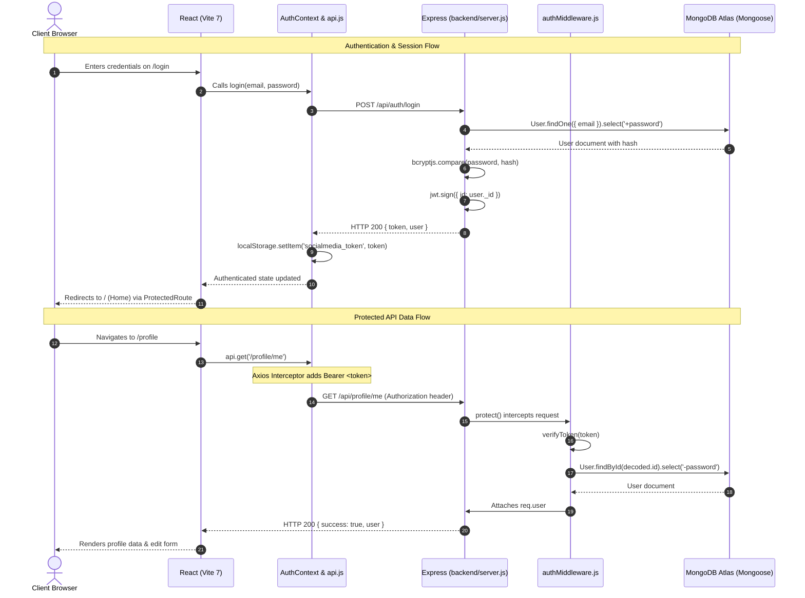

# Social Media Application — Project Overview

> **Repository:** `Malik2627/SOCIAL_MEDIA`  
> **Workspace Root:** `D:\Socialmedia`  
> **Architecture:** Modern MERN Stack + Real-Time Engine (MongoDB, Express, React, Node.js, Socket.io, Cloudinary, Multer)  
> **Current Milestone Status:** Steps 1 through 5E Completed & Verified; Step 5F-A Foundation Prepared  

---

## Part 1: Introduction & Overview

### 1.1 Purpose & Vision
The **Social Media Application** is an enterprise-grade, modern social networking platform designed for seamless user interaction, dynamic media sharing, and instant real-time community engagement. Built with performance, security, and developer ergonomics in mind, the platform delivers a fluid, app-like experience across desktop and mobile devices.

### 1.2 Target Audience & Core Use Cases
- **Content Creators & Everyday Users:** Share life updates, thoughts, photographs, and multimedia stories with followers.
- **Social Discovery:** Discover like-minded individuals, explore trending topics, search for people, and build personal or professional networks.
- **Real-Time Connections:** Converse one-on-one via low-latency direct messaging and receive instant real-time push notifications for interactions (likes, comments, follows).

### 1.3 Key User Journey
```
[Visitor]
    │
    ▼
[Register / Login] ──(Issue JWT)──► [Protected Session]
                                           │
       ┌───────────────────────────────────┼───────────────────────────────────┐
       ▼                                   ▼                                   ▼
[Profile Management]               [Social Discovery]                 [Content Creation]
 • Avatar & Bio                     • User Search                      • Text & Photo Posts
 • Follower / Following Lists       • Follow / Unfollow                • Media via Cloudinary
 • Public Profile View              • Explore Feeds                    • Real-Time Feed
       │                                   │                                   │
       └───────────────────────────────────┼───────────────────────────────────┘
                                           │
                                           ▼
                            [Real-Time Community (Socket.io)]
                             • Live Direct Messages (1-on-1)
                             • Live Alerts & Notifications
```

---

## Part 2: Technology Stack & Component Breakdown

### 2.1 Technology Selection & Architectural Rationale

| Layer | Technology | Version | Architectural Justification |
| :--- | :--- | :--- | :--- |
| **Frontend Framework** | **React** | `19.3.1` | Declarative, component-driven UI with modern concurrency and fast state updates. |
| **Build Tool & Bundler** | **Vite** | `7.3.8` | Next-generation frontend tooling providing lightning-fast Hot Module Replacement (HMR) and optimized Rollup production builds. |
| **Client Routing** | **React Router DOM** | `7.18.5` | Declarative, nested routing enabling layout persistence and declarative route protection. |
| **HTTP Client** | **Axios** | `1.21.1` | Flexible HTTP client with centralized interceptors for automatic Bearer JWT injection and unified error normalization. |
| **Linting & Code Quality** | **Oxlint** | `1.90.0` | High-performance Rust-based linter ensuring clean React hook conventions and zero lint regressions. |
| **Backend Runtime** | **Node.js** | `v24+` | High-throughput asynchronous event loop ideal for I/O-intensive REST APIs and WebSocket traffic. |
| **Web Server Framework** | **Express** | `5.3.0` | Minimalist, unopinionated web framework featuring robust middleware pipelines and native Promise error handling. |
| **Database & ODM** | **MongoDB & Mongoose** | `9.12.1` | Schema-flexible document database hosted on MongoDB Atlas; Mongoose provides strict schema validations, pre/post hooks, and safe data transformations. |
| **Real-Time Communication** | **Socket.io** | `4.8.4` (Client & Server) | Bi-directional, low-latency WebSocket communication with auto-reconnection and room-based channels for chat and push notifications. |
| **Password Security** | **bcryptjs** | `3.0.3` | Industry-standard adaptive salt hashing for zero plain-text password exposure. |
| **Authentication Tokens** | **jsonwebtoken (JWT)** | `9.0.3` | Stateless token-based authentication with cryptographically signed payloads and customizable expiration (`7d`). |
| **Media Handling** | **Multer** | `2.5.0` | Memory-based multipart/form-data middleware buffering temporary uploads safely with strict MIME and size limits. |
| **Cloud Asset Storage** | **Cloudinary** | `2.11.0` | Global CDN media storage providing automatic optimization, resizing, and secure HTTPS image delivery. |

---

### 2.2 Core Component Breakdown

#### Component 1: User Authentication System
- **Current Status:** `COMPLETED & VERIFIED` (Phases 1–3 / Steps 4A–4E & 5A–5D)
- **Implementation Highlights:**
  - Password Hashing using `bcryptjs` with salt rounds; plain-text passwords never touch logs or database records.
  - User Schema with unique constraints on `username` and `email`, plus strict regex validation.
  - `password` field configured with `select: false` so user queries omit hash values by default.
  - Stateless JWT generation with verified expiration and payload sanitization (`User.toJSON` transforms delete password).
  - Centralized Express `authMiddleware.js` validating `Authorization: Bearer <token>` headers.
  - Frontend `AuthContext.jsx` with automatic session restoration via `GET /api/auth/me` on initial page load.
  - Reusable `ProtectedRoute.jsx` guarding authenticated views and redirecting unauthenticated users to `/login`.

#### Component 2: Profile Management
- **Current Status:** 
  - `COMPLETED & VERIFIED` (Steps 5E-A & 5E-B): Safe profile reading (`GET /api/profile/me`), profile updating (`PUT /api/profile/me`), email immutability, bio character limits, instant in-memory AuthContext sync, and responsive UI layout.
  - `IMMEDIATE NEXT IMPLEMENTATION STEP` (Step 5F-A/B/C): Real Cloudinary-backed profile picture upload via Multer memory storage and multipart streaming.
- **Implementation Highlights:**
  - Strict validation preventing unauthorized modification of immutable fields (e.g., email).
  - Username uniqueness checks during updates to avoid handle collisions.
  - Clean fallback avatars when no custom photo is provided.

#### Component 3: Posting, Likes & Commenting (Feed Engine)
- **Current Status:** `PLANNED` (Phase 6 & 7 / Steps 9–16)
- **Planned Highlights:**
  - Dedicated `Post` and `Comment` Mongoose models referencing user object IDs.
  - Post creation with rich text caption, hashtags, and Cloudinary media URLs.
  - Optimistic UI updates for instant like/unlike toggles and comment posting.
  - Chronological and relationship-based feed querying with cursor-based pagination for high performance.

#### Component 4: Real-Time Chat & Notifications (Socket.io)
- **Current Status:** `PLANNED` (Phase 9 & 10 / Steps 17–21; dependencies already pre-installed)
- **Planned Highlights:**
  - `Socket.io` server attached directly to the existing Node.js HTTP server in `server.js`.
  - Authenticated handshake verifying JWT before establishing socket connections.
  - Private 1-on-1 messaging rooms with live typing indicators and read receipts.
  - Global push notification channel alerting users of new likes, comments, and followers.

---

## Part 3: Actual Project Structure & Data Flow

### 3.1 Inspected File & Directory Tree

```text
D:\Socialmedia
├── .gitignore                      # Git exclusion rules (.env, node_modules, dist, logs)
├── README.md                       # High-level architecture and MongoDB configuration guide
│
├── backend/                        # Express 5 REST API & Socket.io Engine
│   ├── .env.example                # Template for environment variables (PORT, MONGO_URI, JWT_SECRET, Cloudinary)
│   ├── package.json                # Dependencies: express, mongoose, jsonwebtoken, bcryptjs, socket.io, cloudinary, multer
│   ├── package-lock.json
│   ├── server.js                   # Application entry point, HTTP server, CORS, middleware, route mounting
│   ├── config/
│   │   ├── cloudinary.js           # Cloudinary v2 SDK configuration and credential verification
│   │   ├── db.js                   # Mongoose connection layer and non-sensitive health check provider
│   │   └── upload.js               # Multer memory storage, 5MB file-size limit, and MIME-type filter
│   ├── controllers/
│   │   ├── authController.js       # User registration, login, and /me endpoint handlers
│   │   └── profileController.js    # Safe profile retrieval and profile update handlers
│   ├── middleware/
│   │   └── authMiddleware.js       # Bearer JWT verification and req.user attachment
│   ├── models/
│   │   └── User.js                 # Mongoose schema: name, username, email, password, profilePicture, bio, followers, following
│   ├── routes/
│   │   ├── authRoutes.js           # /api/auth routes (POST /register, POST /login, GET /me)
│   │   └── profileRoutes.js        # /api/profile routes (GET /me, PUT /me)
│   └── utils/
│       ├── jwt.js                  # Token generation (sign) and verification utilities
│       ├── password.js             # bcryptjs hashing and comparison functions
│       └── userFormatter.js        # Safe user object sanitation and string normalizers
│
└── frontend/                       # React 19 + Vite 7 Single Page Application
    ├── .env                        # Local client environment variables (VITE_API_URL)
    ├── .env.example                # Example client environment template
    ├── .gitignore                  # Frontend specific git ignores
    ├── .oxlintrc.json              # Oxlint linting rules
    ├── index.html                  # HTML entry template
    ├── package.json                # Dependencies: react, react-dom, react-router-dom, axios, socket.io-client
    ├── package-lock.json
    ├── README.md
    ├── vite.config.js              # Vite configuration with @vitejs/plugin-react
    ├── public/
    │   ├── favicon.svg             # Application favicon
    │   └── icons.svg               # SVG sprite sheet for UI icons
    └── src/
        ├── App.css
        ├── App.jsx                 # Route definitions (/login, /register, /, /profile) wrapped in ProtectedRoute
        ├── index.css               # Global CSS custom properties (dark theme palette, spacing, typography)
        ├── main.jsx                # React root mount with BrowserRouter and AuthProvider
        ├── assets/                 # Static graphical assets
        │   ├── hero.png
        │   ├── react.svg
        │   └── vite.svg
        ├── components/
        │   ├── Layout.jsx          # Shell layout wrapping authenticated views with Navbar
        │   ├── Navbar.jsx          # Header navigation bar with active links, user profile pill, and logout
        │   ├── PasswordField.jsx   # Form password input with visibility toggle
        │   └── ProtectedRoute.jsx  # Route guard redirecting unauthenticated traffic to /login
        ├── context/
        │   └── AuthContext.jsx     # Global authentication provider (user, token, login, register, logout, updateUser)
        ├── pages/
        │   ├── Home.jsx            # Authenticated user dashboard with welcome banner and feature teaser cards
        │   ├── Login.jsx           # Sign-in page with client validation and error handling
        │   ├── Profile.jsx         # Profile viewer and edit form with real-time UI synchronization
        │   └── Register.jsx        # Account registration page with strict validation
        ├── services/
        │   └── api.js              # Centralized Axios instance with automatic JWT request interceptor
        ├── styles/
        │   ├── auth.css            # Styles for authentication cards, inputs, and buttons
        │   ├── home.css            # Dashboard welcome card and teaser grid styling
        │   ├── layout.css          # Navigation bar and page container styling
        │   └── profile.css         # Profile avatar, statistics banner, and edit form styling
        └── utils/
            ├── apiError.js         # Safe error message extraction helper
            └── authValidation.js   # Client-side input validation utilities
```

---

### 3.2 Data Flow & System Interactions



### 3.3 Key Architectural Patterns
1. **Decoupled API Client:** `frontend/src/services/api.js` encapsulates all network configuration. Any token retrieved by `AuthContext` is stored in browser storage and injected transparently into request headers via Axios interceptors.
2. **Layered Backend Architecture:** 
   - `server.js` orchestrates middleware, CORS policies, and route mounting.
   - Routes (`routes/`) declare URI mapping and middleware chains.
   - Controllers (`controllers/`) encapsulate business logic, input validation, and HTTP responses.
   - Models (`models/`) define strict MongoDB schemas and sanitize output via `toJSON` transforms.
   - Utilities (`utils/`) isolate cryptography, JWT parsing, and string normalization.
3. **Optimistic & Resilient UI:** Frontend components gracefully handle loading spinners, network downtime, and authentication expiration (`401` automatic logout) without breaking the user experience.

